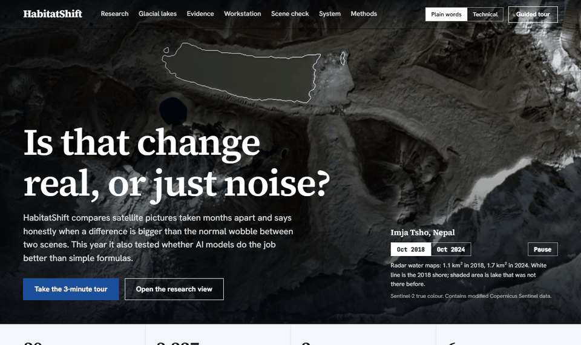

# HabitatShift


**How far can free Sentinel-2 satellite data be trusted to show landscape change, and how do you tell real
change from noise?** HabitatShift measures change between two seasons in six study areas, checks it against
scene-to-scene noise and an independent dataset, and says plainly where the answer is "not reliably".



## Why this project exists

I am from Nepal. In 2026 a flash flood caused heavy damage here, and I wanted to build something that could help
people understand events like it from space. While learning I found that flash floods are hard to see with optical
satellites, because monsoon cloud hides the days that matter, and that the open, repeatable work was mostly on slower
change. So HabitatShift became a careful study of wetlands, forest and urban change, with two Himalayan event studies
(Purepu lake drainage 2025, Langtang rock-ice collapse 2026) kept as the part closest to the original motivation.
They show where optical imagery fails. The natural next step is radar (Sentinel-1), which sees through cloud.

## What it does

| Question | How it is answered | Where to see it |
|---|---|---|
| What changed between two seasons? | Index differences (NDVI, NDWI/MNDWI, NDBI, NDSI) on a shared valid footprint, with threshold sweeps | Workstation, Experiments |
| Is the change bigger than noise? | Per-pixel scene-to-scene spread gives a standard error; a pixel counts only if the change exceeds it | Experiments, "Is the change bigger than the noise?" |
| Does it agree with independent data? | Western Ghats NDVI decrease compared with Hansen forest loss (2021-2024) | Experiments (Western Ghats) |
| Is a two-date comparison misleading? | Monthly series 2020-2026 with a seasonal fit, so the two-date difference can be read against the normal yearly swing | Experiments (Kathmandu, Western Ghats) |
| Can I try my own area? | Draw a box (0.2-6 km2), pick two dates, run the same engine; one run at a time, about 2 minutes | "Your own area" page (needs the local backend) |

## Findings worth knowing

- **Noise test.** At the recorded 0.15 threshold, the share of changed pixels that also exceed scene-to-scene noise
  (3 x SE) ranges from about 18% (Coringa MNDWI, a tidal site) to about 100% (Western Ghats NDVI). Several
  seasonal or tidal studies are mostly within noise. Langtang cannot be tested (one scene in one period).
- **Hansen validation (Western Ghats).** The map catches 62% of recorded forest loss, but only 13% of the pixels it
  flags coincide with recorded loss. The reference has only about 5 loss cells (30 m) in this 24 km2 area, so this is
  indicative. Agreement with another satellite product, not ground truth.
- **Time series.** Kathmandu NDVI drift is about zero (-0.0007 per year, 95% interval -0.0035 to +0.0020), the
  full seasonal swing is about 0.10 peak to peak, and the two-date difference (-0.066) is smaller than that swing, so
  a two-date reading alone cannot separate it from normal seasonal variation. Western Ghats: drift also about zero; two-date difference +0.001.
- **Resolution.** Re-running at 20 m changes urban Kathmandu and snowy Purepu results by up to a few percentage
  points; Western Ghats barely moves.
- **Maps look soft because the data is 10 m.** Kathmandu is 201 x 225 pixels. Colour images are enlarged with a sharper
  filter and data layers show crisp native pixels; no detail is invented.

Full tables: [`docs/RESULTS.md`](docs/RESULTS.md). What changed in version 2: [`docs/CHANGES_V2.md`](docs/CHANGES_V2.md).

## What is not done (honest list)

- No ground-truth field data. Validation is against other satellite products only.
- Two-date study design: seasonal, tidal and phenological differences can look like change.
- Optical only, so monsoon cloud limits event studies. Radar (Sentinel-1) is not integrated.
- Custom-area runs are descriptive, small and run locally; there is no hosted service.
- The ML experiment is kept as a reference layer and reported as agreement with ESA WorldCover, not accuracy.

## Run it

```powershell
py -3.11 -m venv .venv
.venv\Scripts\pip install -r backend\requirements.txt
cd frontend; npm ci; npm run build; cd ..
.venv\Scripts\python.exe -m uvicorn backend.app.api.app:app --host 127.0.0.1 --port 8098
```

Open <http://127.0.0.1:8098/>. On Windows, `start.bat` does all of this and `stop.bat` stops it. Without the backend,
any static file server on `frontend/dist` serves the offline showcase (the custom-area page needs the backend).

## Verification

```powershell
.venv\Scripts\python.exe -m pytest        # 443 backend tests (some read local rasters and skip on a fresh clone)
cd frontend; npm run build                # type-checks and builds
```

Independent audits live in [`verification/`](verification/) and re-derive results without importing production
code; browser suites are in `tools/visual/`. Setup details: [`docs/SETUP_GUIDE.md`](docs/SETUP_GUIDE.md).

## Documentation

| Document | Content |
|---|---|
| [`docs/RESULTS.md`](docs/RESULTS.md) | study results |
| [`docs/METHODOLOGY.md`](docs/METHODOLOGY.md) | methods |
| [`docs/LIMITATIONS.md`](docs/LIMITATIONS.md) | limitations |
| [`docs/ARCHITECTURE.md`](docs/ARCHITECTURE.md) | system design |
| [`docs/DATA_PROVENANCE.md`](docs/DATA_PROVENANCE.md) | data sources and licences |
| [`docs/CHANGES_V2.md`](docs/CHANGES_V2.md) | version 2 changes |
| [`docs/paper/`](docs/paper/) | technical report (HTML and PDF) |
| [`docs/archive/`](docs/archive/) | build history: milestone records, audits, handoffs |

## Data and licences

Sentinel-2 L2A via the Element 84 Earth Search STAC catalogue (AWS Open Data): "Contains modified Copernicus Sentinel
data, processed by ESA". Reference datasets: ESA WorldCover, Global Mangrove Watch, JRC Global Surface Water and
Hansen Global Forest Change, all CC-BY 4.0, recorded in [`docs/DATA_PROVENANCE.md`](docs/DATA_PROVENANCE.md). Code is
MIT-licensed ([`LICENSE`](LICENSE)); data keeps its own licences.
