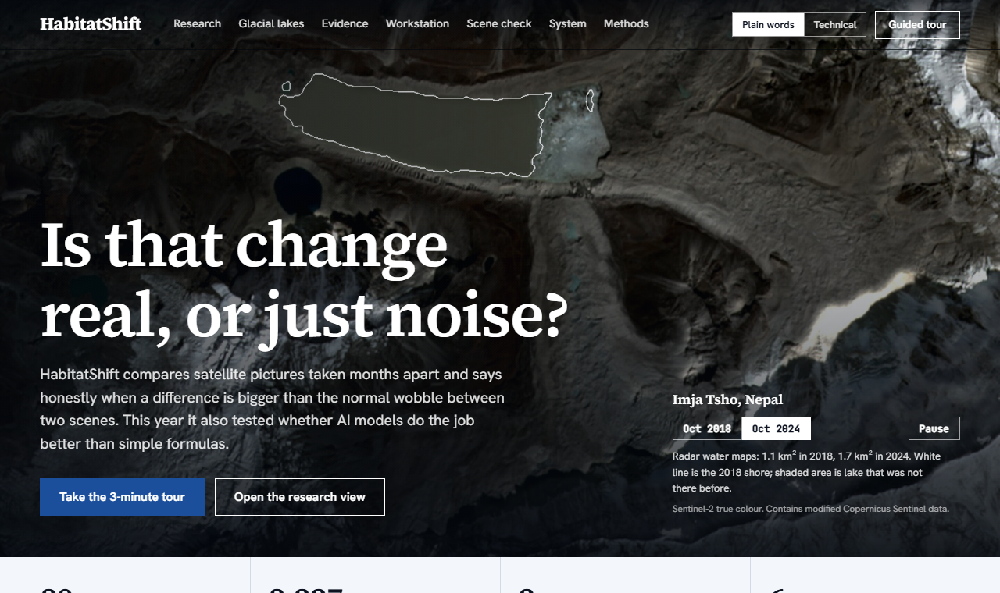
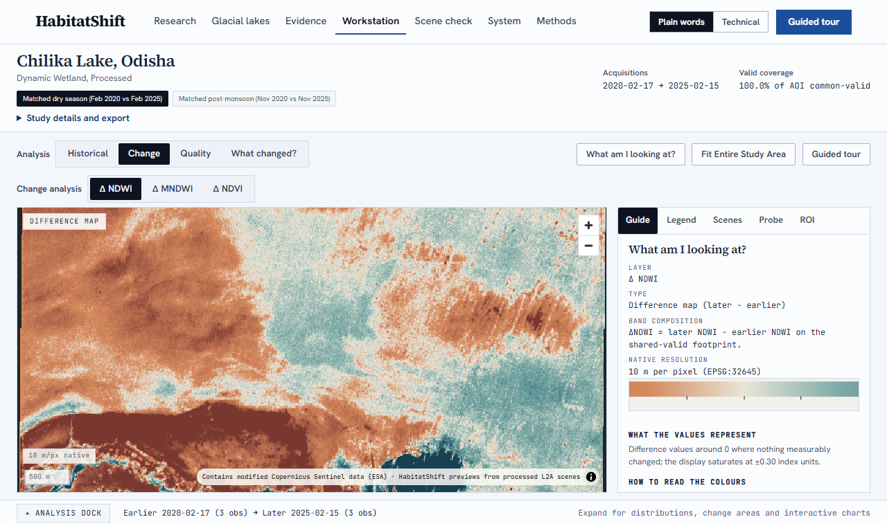
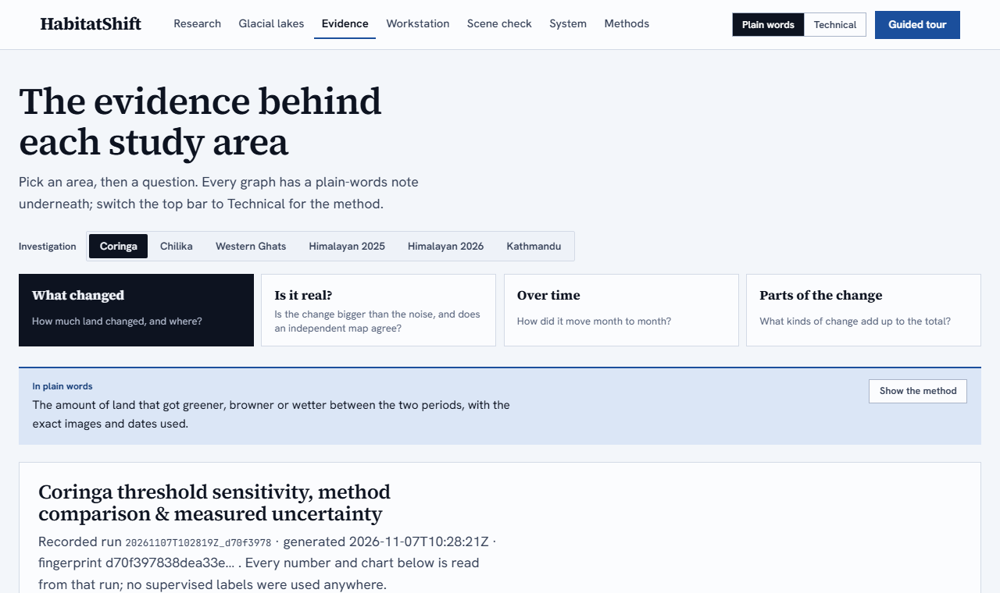
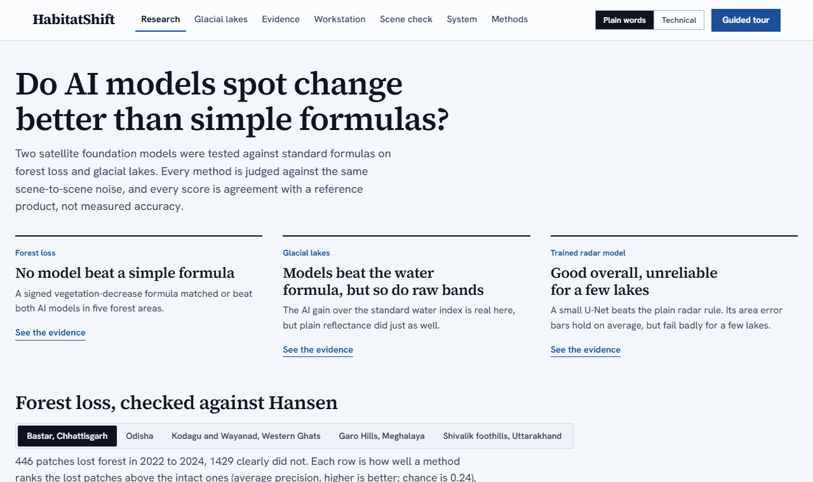

# HabitatShift


[](https://doi.org/10.5281/zenodo.24201720)

**Do geospatial foundation models detect real surface change better than simple spectral indices, once both are judged
against the same scene-to-scene noise, and does the answer hold across fields?** HabitatShift tests that on forest loss
and Himalayan glacial lakes with Sentinel-1 radar and Sentinel-2 optical data, reports the result even where it is
negative, and keeps every number next to its uncertainty. Short answer so far: on forest loss no foundation model beat a
signed NDVI baseline; on glacial lakes they beat the water index but not plain reflectance.

Paper draft: [`docs/paper/v3/`](docs/paper/v3/) (LaTeX source and a PDF preview). Live demo: not hosted yet; run the
static site locally (below).


*The demo above is recorded from the current build: landing page, Chilika Lake swipe, Change and Quality layers, the
analysis dock, then the Evidence page.*

## Why this project exists

I am from Nepal. In 2026 a flash flood caused heavy damage here, and I wanted to build something that could help
people understand events like it from space. While learning I found that flash floods are hard to see with optical
satellites, because monsoon cloud hides the days that matter, and that the open, repeatable work was mostly on slower
change. So HabitatShift became a careful study of wetlands, forest and urban change, with two Himalayan event studies
(Purepu lake drainage 2025, Langtang rock-ice collapse 2026) kept as the part closest to the original motivation.
They show where optical imagery fails. The natural next step is radar (Sentinel-1), which sees through cloud.

## What it does

| Question | How it is answered | Where to see it |
|---|---|---|
| What changed between two seasons? | Index differences (NDVI, NDWI/MNDWI, NDBI, NDSI) on a shared valid footprint, with threshold sweeps | Workstation, Evidence |
| Is the change bigger than noise? | Per-pixel scene-to-scene spread gives a standard error; a pixel counts only if the change exceeds it | Evidence, "Is the change bigger than the noise?" |
| Does it agree with independent data? | Western Ghats NDVI decrease compared with Hansen forest loss (2021-2024) | Evidence (Western Ghats) |
| Is a two-date comparison misleading? | Monthly series 2020-2026 with a seasonal fit, so the two-date difference can be read against the normal yearly swing | Evidence (Kathmandu, Western Ghats) |
| Can I try my own area? | Draw a box (0.2-6 km2), pick two dates, run the same engine; one run at a time, roughly 1-2 minutes | Scene check (needs the local backend) |

## Screens

| Landing page | Workstation, Change layer |
|---|---|
|  |  |
| **Landing page: two paths, plain-words switch** | **Workstation: Chilika Lake change layer** |
|  |  |
| **Evidence: every graph per study area** | **Research: forest loss and glacial lakes against references** |

## Findings worth knowing

- **Noise test.** At the recorded 0.15 threshold, the share of changed pixels that also exceed scene-to-scene noise
  (3 x SE) ranges from about 18% (Coringa MNDWI, a tidal site) to about 100% (Western Ghats NDVI). Several
  seasonal or tidal studies are mostly within noise. Langtang cannot be tested (one scene in one period).
- **Hansen validation (Western Ghats).** The map catches 62% of recorded forest loss, but only 13% of the pixels it
  flags coincide with recorded loss. The reference has only about 5 loss cells (30 m) in this 24 km2 area, so this is
  indicative. Agreement with another satellite product, not ground truth.
- **Time series.** Kathmandu NDVI drift is about zero (-0.0007 per year, 95% interval -0.0035 to +0.0020), the
  full seasonal swing is about 0.10 peak to peak, and the two-date difference (-0.066) is smaller than that swing, so
  a two-date reading alone cannot separate it from normal seasonal variation. Western Ghats: drift also about zero;
  two-date difference +0.001.
- **Resolution.** Re-running at 20 m changes urban Kathmandu and snowy Purepu results by up to a few percentage
  points; Western Ghats barely moves.
- **Maps look soft because the data is 10 m.** Kathmandu is 201 x 225 pixels. Colour images are enlarged with a sharper
  filter and data layers show crisp native pixels; no detail is invented.

## Version 3: do foundation models beat simple formulas?

The question: can geospatial foundation-model embeddings detect real change better than spectral indices, once both are
judged against the same scene-to-scene noise? Details and tables in [`docs/V3_RESULTS.md`](docs/V3_RESULTS.md).

- **Forest loss (Hansen reference, five areas).** A signed NDVI-decrease score matched or beat Prithvi-EO-2.0 and an
  SSL4EO ResNet-50. No foundation model won.
- **Glacial lakes (Sentinel-1 reference).** Prithvi and raw bands beat the MNDWI water index and tied each other.
- **Radar water U-Net.** Trained on 3,227 radar and optical pairs from 30 Nepal lakes. It agrees with optical lake maps
  better than the plain radar rule (IoU 0.70 against 0.55 on unseen lakes, three seeds). Cross-validated area intervals
  cover 87% of scenes at a 90% target but fail badly for a few lakes.
- **Glacial lake time series.** Monthly lake area 2017 to 2026 from radar, optical and the U-Net, three pilot lakes.

The site opens with two paths, a quick tour for newcomers and a research view, and a Plain words / Technical switch in
the top bar changes how every graph is explained. The System page shows what the pipeline has processed.

Full tables: [`docs/RESULTS.md`](docs/RESULTS.md). What changed in version 2: [`docs/CHANGES_V2.md`](docs/CHANGES_V2.md).

## Limitations

- No ground-truth field data. Every reference (Hansen, radar water frequency, optical masks) is another satellite
  product, so scores are agreement, not accuracy.
- Five forest areas (three picked by a label-only search for active clearing) and effectively one changing lake do not
  settle the research question. Urban and wetland fields are not tested (they need Earth Engine reference data), and
  foundation models were compared as frozen embeddings, not fine-tuned.
- The radar U-Net learns from optical labels, which under-detect turbid, icy water, and its conformal area intervals fail
  badly for a few lakes (see `docs/V3_RESULTS.md`).
- Scene check runs on a custom area are descriptive, small and run locally; there is no hosted service.
- The paper has not been submitted anywhere; references need a final check before submission.

## Run it

```powershell
py -3.11 -m venv .venv
.venv\Scripts\pip install -r backend\requirements.txt
cd frontend; npm ci; npm run build; cd ..
.venv\Scripts\python.exe -m uvicorn backend.app.api.app:app --host 127.0.0.1 --port 8098
```

Open <http://127.0.0.1:8098/>. On Windows, `start.bat` does all of this and `stop.bat` stops it. Without the backend,
any static file server on `frontend/dist` serves the offline showcase (the custom-area page needs the backend).

## Reproducing version 3

The 18 trained `model.joblib` files are stored with Git LFS. The Zenodo archive contains only their LFS pointer
files, so for the real models clone from GitHub and run `git lfs pull` (about 800 MB).

```powershell
.venv\Scripts\pip install -r backend\requirements-ml.txt   # torch (CUDA 12.8 build), einops, timm, matplotlib
.venv\Scripts\python.exe scripts\run_fm_evaluation.py          # forest loss against Hansen
.venv\Scripts\python.exe scripts\run_fm_lake_evaluation.py     # glacial lakes against radar
.venv\Scripts\python.exe scripts\build_lake_training_pairs.py  # radar and optical pairs, 30 lakes
.venv\Scripts\python.exe scripts\train_lake_unet.py            # U-Net, lake and time split
.venv\Scripts\python.exe scripts\cv_lake_unet.py               # 5-fold lake cross-validation and conformal intervals
.venv\Scripts\python.exe scripts\make_paper_figures.py         # paper figures; then scripts\build_paper.py
```

Scene downloads need the internet and take hours (the 30-lake pair build is about 5 hours); scripts are resumable.
The evaluation scripts expect the study scenes to be prepared first (`scripts/fm_make_study.py`, then
`scripts/fm_prepare_scenes.py`). The model weights (Prithvi-EO-2.0, SSL4EO) are downloaded separately into
`data/models/`; their SHA-256 is recorded in each evaluation output.

## Verification

```powershell
.venv\Scripts\python.exe -m pytest        # 502 backend tests (some read local rasters and skip on a fresh clone)
cd frontend; npm run build                # type-checks and builds
```

Independent audits live in [`verification/`](verification/) and re-derive results without importing production
code; browser suites are in `tools/visual/`. The demo GIF frames come from `tools/visual/capture_demo_gif_frames.mjs`
(Playwright, run against a started backend). Setup details: [`docs/SETUP_GUIDE.md`](docs/SETUP_GUIDE.md).

## Documentation

| Document | Content |
|---|---|
| [`docs/RESULTS.md`](docs/RESULTS.md) | study results |
| [`docs/METHODOLOGY.md`](docs/METHODOLOGY.md) | methods |
| [`docs/LIMITATIONS.md`](docs/LIMITATIONS.md) | limitations |
| [`docs/ARCHITECTURE.md`](docs/ARCHITECTURE.md) | system design |
| [`docs/DATA_PROVENANCE.md`](docs/DATA_PROVENANCE.md) | data sources and licences |
| [`docs/CHANGES_V2.md`](docs/CHANGES_V2.md) | version 2 changes |
| [`docs/LEARNING.md`](docs/LEARNING.md) | plain-language study guide to every concept used |
| [`docs/paper/`](docs/paper/) | technical report (PDF, built from `docs/paper/report/`) |
| [`docs/archive/`](docs/archive/) | build history: milestone records, audits, handoffs |

## Data and licences

Sentinel-2 L2A via the Element 84 Earth Search STAC catalogue (AWS Open Data): "Contains modified Copernicus Sentinel
data, processed by ESA". Reference datasets: ESA WorldCover, Global Mangrove Watch, JRC Global Surface Water and
Hansen Global Forest Change, all CC-BY 4.0, recorded in [`docs/DATA_PROVENANCE.md`](docs/DATA_PROVENANCE.md). Code is
MIT-licensed ([`LICENSE`](LICENSE)); data keeps its own licences.
