# HabitatShift — architecture

HabitatShift is a local, single-machine scientific research platform. The
server binds `127.0.0.1` only; there is no deployment, no external service
and no credential anywhere.

```mermaid
flowchart LR
    subgraph Sources["External data (read-only, anonymous)"]
        STAC["Earth Search STAC API\n(sentinel-2-l2a)"]
        COG["Sentinel-2 L2A COGs\n(AWS Open Data)"]
        WC["ESA WorldCover v200 COGs\n(2021 reference labels)"]
    end

    subgraph Acquisition["backend/app/acquisition + catalog"]
        SEARCH["catalog search\n(AOI ∩ date, cloud filter)"]
        READ["bounded COG window reads\n(WarpedVRT, budgeted bytes)"]
        RADIOMETRY["radiometry verification\nempirical acceptance test"]
    end

    subgraph Science["backend/app/preprocess + analysis + experiments"]
        MASKS["SCL masking\n(common-valid grid)"]
        COMPOSITE["median compositing\n(indices NDVI/NDWI/MNDWI/NDSI/NDBI)"]
        CHANGE["change detection\nthresholds + connected components\n(MMU 25 px, top-5 per index/direction)"]
        M2["M2 experiments\nthreshold sweeps · estimator families\nspatial block bootstrap"]
        ML["M5 ML\nRandom Forest vs WorldCover\n(1 km block folds)"]
    end

    subgraph Evidence["Sealed evidence layer"]
        MANIFESTS["data/manifests/*.json\n(full provenance + SHA-256)"]
        FINDINGS["data/findings/*.json\nhabitatshift-findings/2\n+ evidence-record/1"]
        M5ML["data/findings_m5ml/*.json\n(additive ML layer)"]
    end

    subgraph Product["Frontend (React + TS + MapLibre)"]
        EXPLORE["Explore the Evidence"]
        RESEARCH["Research Mode"]
        ADAPTER["Shared Evidence Adapter\n(one read path, no recomputation)"]
        SHOWCASE["Offline Showcase\n(frontend/public/studies)"]
    end

    STAC --> SEARCH --> READ --> RADIOMETRY --> MASKS --> COMPOSITE --> CHANGE
    COG --> READ
    WC --> ML
    CHANGE --> MANIFESTS --> FINDINGS
    COMPOSITE --> M2
    COMPOSITE --> ML
    M2 --> MANIFESTS
    ML --> M5ML
    FINDINGS --> ADAPTER
    M5ML --> ADAPTER
    ADAPTER --> EXPLORE
    ADAPTER --> RESEARCH
    ADAPTER --> SHOWCASE
```

## Components

| Layer | Location | Responsibility |
|---|---|---|
| Catalog & acquisition | `backend/app/catalog`, `backend/app/acquisition` | STAC search, bounded windowed COG reads, radiometric convention verification with the empirical acceptance test |
| Preprocessing | `backend/app/preprocess` | SCL mask policy, grid definition (auto UTM, 10 m), median compositing, previews |
| Analysis | `backend/app/analysis`, `backend/app/indices` | Δ-index change detection, threshold classification, area arithmetic (planimetric UTM pixel area) |
| Experiments | `backend/app/experiments` | M2 threshold sweeps, estimator families, spatial block bootstrap |
| ML (M5) | `scripts/run_m5_ml.py`, `scripts/run_m5_training_imagery.py` | label-gated Random Forest experiments, trained on 2021-epoch imagery, evaluated as agreement with WorldCover |
| Evidence | `backend/app/provenance`, `scripts/generate_findings.py` | schema-validated manifests, sealed evidence records (output checksums, git commit, software versions) |
| API | `backend/app/api/app.py` | FastAPI on 127.0.0.1, id-sanitised routes, path-traversal guards |
| Frontend | `frontend/src` | Explore the Evidence, Research Mode, pixel probe, offline Showcase; one shared Evidence Adapter (`frontend/src/evidence/adapter.ts`) so both experiences render the same records |

## Invariants worth knowing

1. **No recomputation in the UI.** Every displayed number is read from a
   sealed record through the adapter; browser suites assert UI numbers equal
   the records at recorded precision.
2. **Content-addressed, policy-versioned caches.** Observation cache keys
   embed the radiometry policy version; records written under a superseded
   policy cannot be loaded.
3. **Frozen outputs are immutable.** Every milestone reads its predecessors'
   artifacts; the M5 fresh-environment reproduction regenerates a study into
   a sandbox and verifies byte-identical rasters.
4. **Independence of audits.** The audit scripts (`scripts/audit_*.py`)
   deliberately do not import production code — they re-implement the
   documented spec.
