# Architecture

HabitatShift runs on one machine. The server listens on `127.0.0.1` only, and there is no hosted service and no
stored credential.

```mermaid
flowchart LR
    subgraph Sources["External data (read-only, no login)"]
        STAC["Earth Search STAC API\n(sentinel-2-l2a)"]
        COG["Sentinel-2 L2A COGs\n(AWS Open Data)"]
        WC["ESA WorldCover v200\n(2021 reference labels)"]
    end

    subgraph Acquisition["backend/app/acquisition + catalog"]
        SEARCH["catalog search\n(area and date, cloud filter)"]
        READ["bounded COG window reads"]
        RADIOMETRY["radiometry check"]
    end

    subgraph Science["backend/app/preprocess + analysis + experiments"]
        MASKS["cloud masking (SCL)\nshared valid footprint"]
        COMPOSITE["median composites and indices\nNDVI NDWI MNDWI NDSI NDBI"]
        CHANGE["change detection\nthresholds + connected patches"]
        EXP["experiments\nthreshold sweeps, estimators,\nblock bootstrap"]
        ML["Random Forest vs WorldCover\n(1 km block folds)"]
    end

    subgraph Evidence["Recorded results"]
        MANIFESTS["data/manifests/*.json\n(provenance + SHA-256)"]
        FINDINGS["data/findings/*.json"]
        MLF["data/findings_m5ml/*.json\n(ML layer, kept separate)"]
    end

    subgraph Product["Frontend (React + TypeScript + MapLibre)"]
        EXPLORE["Explore"]
        RESEARCH["Research mode"]
        ADAPTER["one shared reader\n(no recomputation)"]
        SHOWCASE["offline showcase\n(frontend/public/studies)"]
    end

    STAC --> SEARCH --> READ --> RADIOMETRY --> MASKS --> COMPOSITE --> CHANGE
    COG --> READ
    WC --> ML
    CHANGE --> MANIFESTS --> FINDINGS
    COMPOSITE --> EXP
    COMPOSITE --> ML
    EXP --> MANIFESTS
    ML --> MLF
    FINDINGS --> ADAPTER
    MLF --> ADAPTER
    ADAPTER --> EXPLORE
    ADAPTER --> RESEARCH
    ADAPTER --> SHOWCASE
```

## Components

| Layer | Location | Job |
|---|---|---|
| Catalog and acquisition | `backend/app/catalog`, `backend/app/acquisition` | STAC search, bounded windowed reads, radiometry check |
| Preprocessing | `backend/app/preprocess` | cloud-mask policy, 10 m UTM grid, median composites, previews |
| Analysis | `backend/app/analysis`, `backend/app/indices` | index differences, thresholds, area from UTM pixel area |
| Experiments | `backend/app/experiments` | threshold sweeps, estimator families, block bootstrap, noise test |
| Machine learning | `scripts/run_m5_ml.py`, `scripts/run_m5_training_imagery.py` | Random Forests trained on 2021 imagery, reported as agreement with WorldCover |
| Provenance | `backend/app/provenance`, `scripts/generate_findings.py` | validated manifests, records with output checksums, git commit and software versions |
| API | `backend/app/api/app.py` | FastAPI on 127.0.0.1, sanitised ids, path-traversal guards |
| Frontend | `frontend/src` | Explore, Research mode, pixel probe, offline showcase, one shared reader in `frontend/src/evidence/adapter.ts` |

## Rules the code keeps

1. **The UI never recomputes.** Every number on screen is read from a recorded result. Browser tests check that UI
   numbers equal the records.
2. **Caches are keyed by content and policy version.** A record written under an older radiometry policy cannot be
   loaded.
3. **Recorded outputs are not edited.** New work reads earlier results; the fresh-environment reproduction
   regenerates a study in a sandbox and checks the rasters are byte-identical.
4. **Audits are independent.** The scripts in `verification/audit_*.py` re-implement the documented method without
   importing production code.
