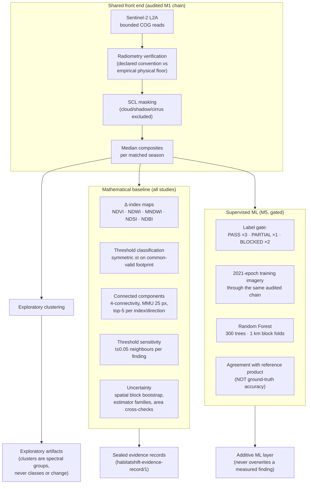

# HabitatShift — methodology

The scientific methodology is **hybrid by design**:

> Mathematical/statistical change detection is the baseline.
> Machine learning is an additional method, used only where appropriate
> independent training and validation data exist.

## 1. Mathematical change detection (baseline)

Documented in full in [`SCIENCE_PROTOCOL.md`](SCIENCE_PROTOCOL.md). Key
rules: matched seasonal windows, ≥ 1 (typically 3) usable observations per
period, per-pixel valid masks (SCL + finite reflectance), common-valid
intersection as the denominator, symmetric inclusive thresholds, area as
projected UTM pixel area with a geodesic cross-check, minimum mapping unit
25 px (0.25 ha at 10 m), findings addressed by content-derived `evidence_id`
with per-finding threshold-sensitivity neighbours.

## 2. Uncertainty (five separate categories, never one score)

1. **Measurement uncertainty** — spatial block bootstrap CIs (Coringa M2;
   block-size sensitivity measured in M5).
2. **Observation-selection uncertainty** — estimator families
   (single pairs, leave-one-out, composite mean/median).
3. **Threshold sensitivity** — sweeps 0.05–0.25 + per-finding ±0.05 neighbours.
4. **Classification uncertainty** — M5 per-class metrics, support gating,
   geographic hold-out ranges.
5. **Reference-label uncertainty** — agreement framing, label provenance,
   recorded source disagreements (Coringa mangrove).

## 3. Machine learning (M5, strictly label-gated)

`M5_ML_LABEL_FEASIBILITY.md` → `M5_ML_METHODOLOGY.md` →
`M5_EXPERIMENT_RESULTS.md`. In short: Random Forests are implemented only
for the studies whose reference labels passed the feasibility gate; features
are the audited reflectance/indices; the split is 1 km block folds (no
pixel ever crosses folds); every metric is "agreement with the ESA
WorldCover v200 reference product"; classes below 50 test pixels are not
reported; application to 2020/2025 epochs is a recorded assumption, not a
verified fact. Both Himalayan studies deliberately have no classifier.

## 4. Interpretation guardrails (in-product, audited)

- Findings are **candidate spectral signals**, never verified environmental
  change.
- ML outputs are **model predictions against reference labels**, marked as
  such everywhere they appear (`evidence_status:
  MODEL_OUTPUT_AGAINST_REFERENCE`).
- An independent negation-aware disclosure audit scans every ML surface for
  unqualified accuracy or ground-truth claims (`audit_m5ml_disclosure.py`,
  96/96).
- PARTIAL-evidence studies carry prominent in-product notes.
