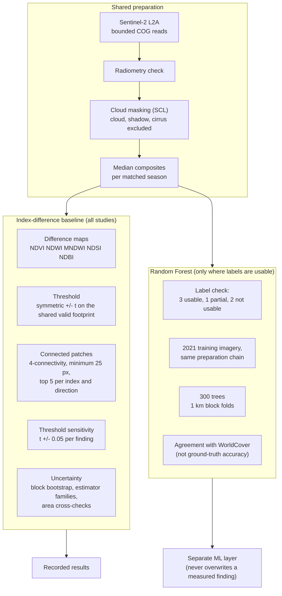

# Methodology

The approach is hybrid. Simple, checkable change detection is the baseline. Machine learning is added only where
independent reference data exist, and it is always reported as agreement with that reference.

Version 2 added three further checks on top of this baseline: a per-pixel noise test, validation against Hansen
forest loss, and monthly time series with a seasonal fit. They are described in [`RESULTS.md`](RESULTS.md).

## 1. Index-difference baseline

The full rules are in [`SCIENCE_PROTOCOL.md`](SCIENCE_PROTOCOL.md). In short:

- matched seasonal windows, at least one (usually three) usable scene per period
- a pixel is compared only if it is valid in every scene used (cloud mask and finite reflectance)
- symmetric thresholds on the shared valid footprint, which is also the denominator for percentages
- area is projected UTM pixel area, cross-checked geodesically
- minimum patch size 25 pixels (0.25 ha at 10 m)
- each finding has a content-derived id and threshold-sensitivity neighbours

## 2. Uncertainty: five separate kinds, never one score

1. **Measurement:** spatial block bootstrap confidence intervals, with block-size sensitivity.
2. **Scene choice:** estimator families (single pairs, leave-one-out, composite mean and median).
3. **Threshold:** sweeps from 0.05 to 0.25 plus per-finding +/- 0.05 neighbours.
4. **Classification:** per-class metrics, support gating, geographic hold-out ranges.
5. **Reference labels:** agreement framing, label provenance, recorded disagreements between sources (Coringa
   mangroves).

## 3. Machine learning

Random Forests exist only for studies whose reference labels passed a feasibility check. Features are the same
reflectance bands and indices. The split uses 1 km block folds so no pixel crosses folds. Every metric is
"agreement with ESA WorldCover v200", and classes with fewer than 50 test pixels are not reported. Applying a
2021-trained model to the 2020 and 2025 dates is a recorded assumption, not a verified fact. The two Himalayan
studies deliberately have no classifier. Details: [`archive/M5_ML_LABEL_FEASIBILITY.md`](archive/M5_ML_LABEL_FEASIBILITY.md),
[`archive/M5_ML_METHODOLOGY.md`](archive/M5_ML_METHODOLOGY.md) and
[`archive/M5_EXPERIMENT_RESULTS.md`](archive/M5_EXPERIMENT_RESULTS.md).

## 4. Wording rules in the product

- Findings are **candidate spectral signals**, never verified environmental change.
- Machine-learning output is marked as a model prediction against reference labels everywhere it appears.
- A disclosure audit (`verification/audit_m5ml_disclosure.py`) scans every ML surface for unqualified claims of
  accuracy or ground truth.
- Studies with only partial evidence carry a visible note.
