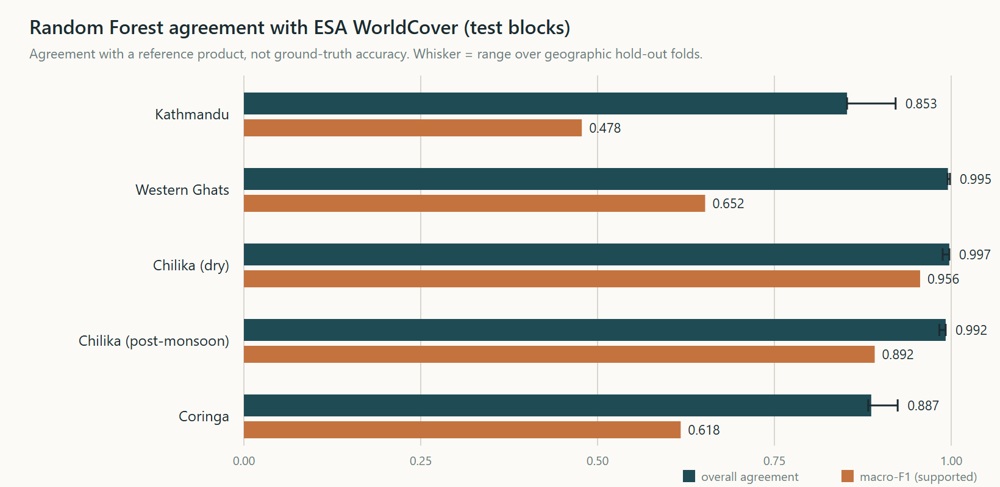
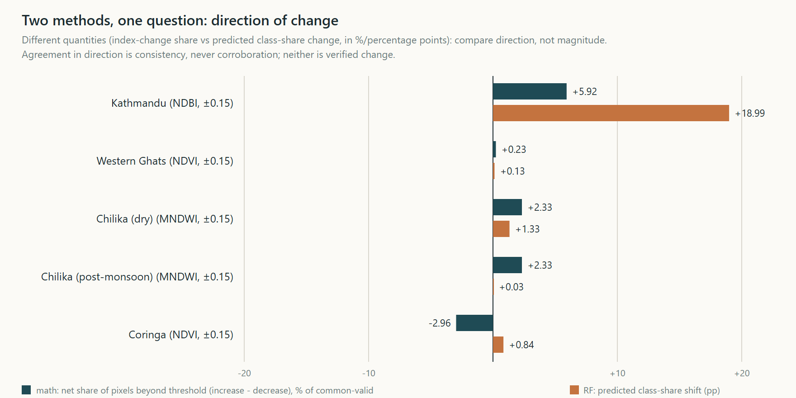
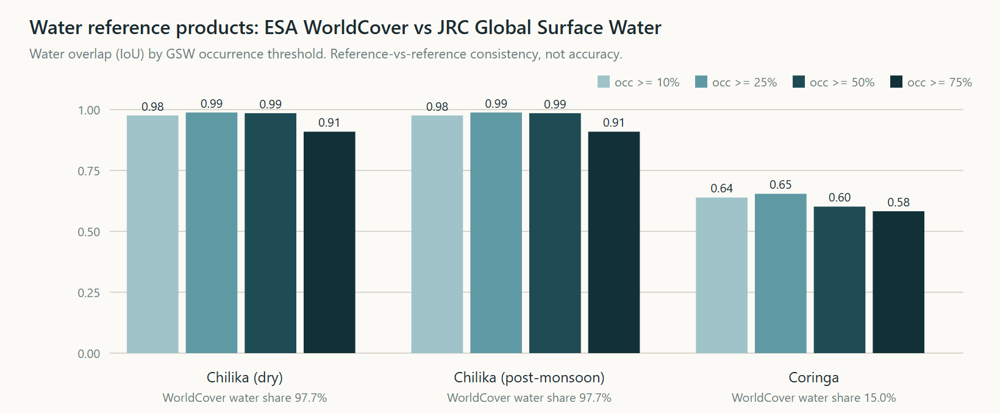
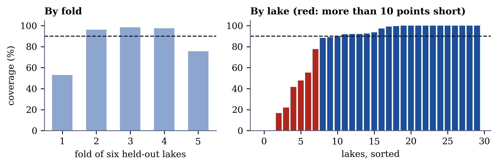
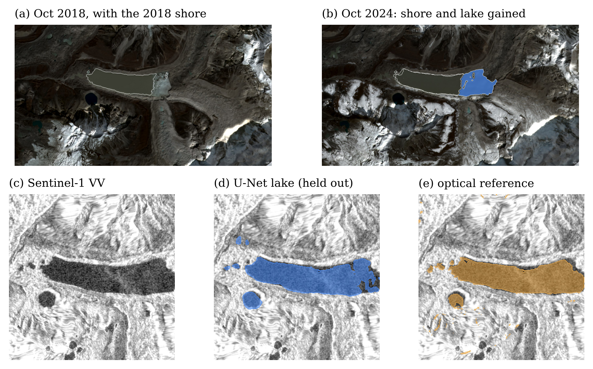

# HabitatShift: a reproducible, audited pipeline for Sentinel-1/2 change analysis

Author: Ayush Khanal; Pragyan Kumar Singh
Affiliation: Andhra University
Status: Technical report, platform versions 1 to 3, November 2026

## Abstract

HabitatShift is an open research platform that measures candidate surface changes between two past dates from Sentinel-2 optical and Sentinel-1 radar imagery, and records enough provenance to re-derive every number it reports. The platform grew in three versions. Version 1 is a verified processing chain (radiometry checks, cloud masking, spectral-index differences, threshold sweeps, spatial block-bootstrap intervals) with Random Forest classifiers added only where reference labels pass a feasibility gate. Version 2 adds a noise-aware change test that asks whether a pixel's change exceeds the scene-to-scene spread of its own period, validation of a forest-loss map against Hansen Global Forest Change, monthly time series with a seasonal fit, and bounded runs on a user-drawn area. Version 3 adds foundation-model change scores in the same noise units, a pre-registered five-area forest-loss evaluation, and a radar water model with conformal area intervals for Nepal glacial lakes. Independent audit scripts that import no production code re-derive the processing chain, and all of them pass in the run reported here (5,552 checks for the scientific audit; 2,837 for the findings audit). Every machine-learning metric is reported as agreement with a reference product, never as accuracy against ground truth. The research question of version 3 is evaluated in a companion paper; this report documents the platform, its audit and its reproducibility.

## 1 Introduction

Satellite change demonstrations commonly pair a classifier score with an attractive map. That presentation hides three questions a reader needs answered: which observations were used, how sensitive the result is to analyst choices, and what the labels actually measure. HabitatShift was built to make those questions first-class. It treats every result as a candidate spectral signal between two dates, never as verified environmental change, and it records provenance for each number.

This report documents the whole platform in one place so that it can be cited and reproduced. Section 2 describes the data, Section 3 the methods of each version, Section 4 the experimental design, Section 5 results from versions 1 and 2, Section 6 the components added in version 3, Section 7 the audit and reproducibility record, and Section 8 the limitations. The version 3 research question, whether foundation-model embeddings detect surface change better than spectral indices, is evaluated in a separate paper that this report supports.

## 2 Data

**Imagery.** Sentinel-2 MSI Level-2A surface reflectance from the Element 84 Earth Search STAC catalogue (anonymous, byte-range reads of cloud-optimised GeoTIFFs). Each study uses matched seasonal windows in two years (for example Chilika: February 2020 and February 2025; a post-monsoon pair is also processed), with typically three usable observations per period combined into median composites on one 10 m grid per study. Version 3 adds Sentinel-1 RTC radar from Microsoft Planetary Computer for glacial lakes.

**Reference labels.** ESA WorldCover v200, 2021 epoch [@zanaga2022], is the label source for the supervised experiments of version 1. Global Mangrove Watch v3.0 [@bunting2022] was inspected for Coringa; it disagrees with WorldCover inside the study area, so no mangrove classifier was trained. Dynamic World was excluded because agreeing with another model's output is model-to-model comparison. JRC Global Surface Water [@pekel2016] is used as a second water reference in a cross-check (Section 5.4), not for training. Hansen Global Forest Change v1.12 [@hansen2013] is the forest-loss reference of versions 2 and 3, and Hi-MAG glacial-lake outlines [@chen2021himag] define the lakes of version 3.

**Context.** Copernicus GLO-30 DEM is used for interpretation only, never as an input to the indices.

All references are other satellite products. Scores against them are agreement, not accuracy.

## 3 Methods

### 3.1 Processing chain

Windowed COG reads are verified per item for radiometric convention: scale and offset are resolved per asset, and an empirical physical-floor test detects stored values that do not match declared metadata (a measured inconsistency in 2025 Earth Search reprocessing is handled this way and documented). Scene Classification Layer masking excludes cloud, shadow and cirrus; per-pixel validity is the intersection of masks and finite reflectance. Area is projected UTM pixel area with a geodesic cross-check.

### 3.2 Mathematical baseline

Spectral indices (NDVI, NDWI, MNDWI, NDBI and, for mountains, NDSI) are differenced between periods on the common-valid footprint. Symmetric inclusive thresholds (primary $\pm 0.15$) classify decrease and increase; sweeps over 0.05 to 0.25 show threshold dependence. Connected components (4-connectivity, minimum mapping unit 25 pixels) form a curated top-five-per-index-direction findings set. Uncertainty is measured by spatial block bootstrap (Coringa), estimator families (single pairs, leave-one-out, composite mean and median) and minimum-mapping-unit sensitivity.

### 3.3 Label-gated machine learning

A feasibility gate probed every reference source live: three studies passed, one was partial, two were blocked (both Himalayan studies). Passing studies use a Random Forest [@breiman2001; @pedregosa2011] (300 trees, balanced subsample class weights, fixed seed) on reflectance bands and indices from a 2021 training epoch produced by the same audited chain. Evaluation uses contiguous 1 km block folds so no pixel crosses a fold [@roberts2017], plus a three-fold geographic hold-out analysis. Classes with fewer than 50 test pixels are reported as not reported. The trained model is then applied to the two study epochs; that cross-epoch application is a recorded assumption.

### 3.4 Noise-aware change test (version 2)

For each pixel, the standard error of a period-to-period difference is $\mathrm{SE} = \sqrt{s_e^2/n_e + s_l^2/n_l}$, where $s$ is the per-pixel standard deviation across the scenes of the earlier and later period (floor 0.02) and $n$ the number of scenes. A pixel is noise-supported when $|\Delta| > k \cdot \mathrm{SE}$, with $k = 2$ or $3$. Scene-to-scene spread measures acquisition noise only. It cannot see seasonal, tidal or phenological differences between the periods and is itself uncertain with two or three scenes, so a noise-supported pixel is not proof of real change and an unsupported one is not proof of none.

### 3.5 Time series and custom-area runs (version 2)

The monthly series takes the best usable scene per calendar month, never fills gaps, and fits a seasonal harmonic with a linear trend; the trend interval and the seasonal amplitude let a two-date difference be read against the normal yearly swing. The custom-area page runs the same engine on a user-drawn box of 0.2 to 6 km$^2$ between two chosen dates, one run at a time on the local machine.

### 3.6 Vector noise score and foundation-model features (version 3)

Version 3 generalises the noise test to feature vectors. Each scene is reduced to one vector per $16 \times 16$ pixel patch (160 m); with $\bar f_A$ and $\bar f_B$ the mean vectors of the earlier and later period and $\sigma^2$ the mean half squared distance between scenes of one period (pooled over a $3 \times 3$ neighbourhood), the score is
$$z^2 = \frac{\lVert \bar f_B - \bar f_A \rVert^2}{\sigma^2\,(1/n_A + 1/n_B)},$$
which is about 1 when nothing has changed, whatever the length or scale of the features. The features compared are single indices, six standardised reflectance bands, the encoder of Prithvi-EO-2.0-300M [@szwarcman2024] (weights SHA-256 `faab2c8b776f0723f93431747603a7ec586a54fc45473613b4322c29752486e7`) and layer-3 features of an SSL4EO-S12 ResNet-50 [@wang2022ssl4eo] on the RGB bands (weights SHA-256 `2b57ba8b9964dbe1c409aac1bb79b4d97c19c874ffe7934799b7c8ad94ff85f0`). The evaluation against reference data, with spatial block-bootstrap intervals and a placebo test, is reported in the companion paper.

### 3.7 Independent audit

Separate audit scripts re-derive scene identity, dates, CRS, scale factors, masks, indices, composites, deltas, classes, areas and bootstrap draws from live source records and cached pixels without importing production code. A negation-aware disclosure audit scans every machine-learning surface for unqualified accuracy or ground-truth language.

## 4 Experimental design

Studies, periods and thresholds were fixed before results were generated and stored in a registry. Scientific outputs from earlier milestones are frozen; later work is additive and references frozen records by SHA-256. The version 3 forest areas were registered before any score was computed (`studies/forest_expansion_prereg.yaml`), including one documented amendment made after a label-only screen and before any scene was downloaded.

## 5 Results of versions 1 and 2

### 5.1 Mathematical change detection

Table: Recorded signal at $|\Delta| \geq 0.15$ for each study. {#tab:math}

| Study | Periods | Recorded signal |
|---|---|---|
| Chilika (dry) | 2020-02 to 2025-02 | NDWI 4.20% lower, 22.34% higher (146.09 and 777.89 ha of 3,373 ha): redistribution, not a loss signal |
| Chilika (post-monsoon) | 2020-11 to 2025-11 | NDWI 11.51% lower, 3.60% higher (388.10 and 121.70 ha) |
| Western Ghats | 2020-02 to 2025-02 | NDVI 0.14% lower, 0.38% higher (3.45 and 8.99 ha of 2,377 ha): essentially stable; no deforestation claim is possible |
| Kathmandu | 2020-03 to 2025-03 | NDBI-led candidate increase; built-up and bare-soil confusion guardrails recorded |
| Himalaya (Purepu 2025, Langtang 2026) | event windows | Partial evidence; optical-only limits shown in the product |

### 5.2 Random Forest agreement with WorldCover

Table: Random Forest agreement with WorldCover on held-out 1 km blocks: overall agreement, macro-F1 over supported classes, and the range of overall agreement across three geographic hold-out folds. Agreement with a reference product, not accuracy against reality. {#tab:rf}

| Study | Overall agreement | Macro-F1 | Hold-out range |
|---|---|---|---|
| Chilika (dry) | 0.997 | 0.956 | 0.988 to 0.997 |
| Chilika (post-monsoon) | 0.992 | 0.892 | 0.983 to 0.992 |
| Western Ghats | 0.995 | 0.652 | 0.995 to 0.998 |
| Coringa | 0.887 | 0.618 | 0.883 to 0.924 |
| Kathmandu | 0.853 | 0.478 | 0.853 to 0.921 |

{#fig:rf width=0.95}

Agreement is high where the problem is nearly binary and the area is dominated by one class (Chilika). It is lower and less stable in Kathmandu, where the bare class is never predicted (F1 0.000 on 153 test pixels) and the water class has no test pixels and is gated. Western Ghats macro-F1 is limited by a 4% minority class. Coringa has a supervised experiment for vegetation, water and other, but none for mangroves.

### 5.3 Two methods, one question

{#fig:direction width=0.95}

Directions agree in four of five experiments (Kathmandu, Western Ghats and both Chilika pairs); in Coringa the vegetation-index net share falls (-2.96) while the predicted vegetation class share rises slightly (+0.84 percentage points). The disagreement is reported rather than resolved: the two quantities measure different things, and neither is treated as verification.

### 5.4 Water reference cross-check

{#fig:water width=0.95}

Overlap is 0.98 to 0.99 for Chilika at thresholds up to 50% (WorldCover labels 97.7% of the area water), dropping to 0.91 at 75% because permanent-water filtering excludes seasonal lagoon area. For Coringa overlap is 0.58 to 0.65: the two products disagree about tidal and aquaculture water, which supports treating either as a reference rather than truth. GSW summarises 1984 to 2021 while WorldCover is a 2021 snapshot.

### 5.5 Robustness

Recorded 25-pixel findings are unaffected by the minimum mapping unit, but collections thin out at 50 pixels (Western Ghats NDVI decrease components 7, 3 and 0 for units of 10, 25 and 50). Bootstrap block size from 10 to 30 pixels widens the Coringa NDVI interval (width 0.017 to 0.028), with the recorded 15-pixel design inside that range. Withholding feature groups changes agreement by at most about 0.01, so features are largely redundant. Five uncertainty categories (measurement, observation selection, threshold, classification, reference label) are kept separate and are never combined into one score.

### 5.6 Noise-aware test (version 2)

Table: Share of fixed-rule changed pixels (primary threshold 0.15) that also exceed three standard errors of scene-to-scene noise. {#tab:noise}

| Study and index | Fixed-rule pixels testable | Share also noise-supported |
|---|---|---|
| Western Ghats NDVI | 1,244 | 99.9% |
| Chilika (dry) NDVI | 130,236 | 95.9% |
| Chilika (dry) NDWI | 92,398 | 85.4% |
| Kathmandu NDBI | 3,374 | 97.2% |
| Chilika (post-monsoon) NDWI | 50,980 | 31.4% |
| Coringa MNDWI | 44,461 | 18.2% |

The share ranges from about 18% (Coringa MNDWI, a tidal site) to about 100% (Western Ghats NDVI). Several seasonal or tidal studies are mostly within noise. Langtang cannot be tested because it has one scene in one period.

### 5.7 Hansen validation and time series (version 2)

For the Western Ghats area the NDVI decrease rule catches 62% of Hansen forest loss in 2021 to 2024 (28 of 45 pixels) but only 13% of the pixels it flags coincide with recorded loss (precision 0.128, 28 of 219 flagged pixels in forest). The reference holds only about 5 loss cells of 30 m in this 24 km$^2$ area, so the result is indicative, and it is agreement with another satellite product, not accuracy.

In the Kathmandu monthly NDVI series (77 months, five gaps recorded and never filled) the linear trend is $-0.0007$ per year (95% interval $-0.0035$ to $+0.0020$) with a fitted seasonal amplitude of 0.052; in Western Ghats the trend is $-0.0004$ per year (interval $-0.0034$ to $+0.0027$). Both trends are consistent with zero, and the seasonal swing is larger than the two-date differences, so a two-date reading alone cannot separate change from normal seasonal variation.

## 6 Components added in version 3

### 6.1 Forest-loss evaluation

The evaluation of foundation-model scores against Hansen loss in five areas (Bastar, Odisha, Kodagu and Wayanad, Garo Hills, Shivalik foothills), the lake evaluation and the placebo test on twelve areas are reported in the companion paper. In every one of the five forest areas no foundation model beat a signed NDVI-decrease baseline. Three of the five boxes were chosen by a label-only search for active clearing, so the areas over-represent active loss.

### 6.2 Radar water model and conformal lake-area intervals

For 30 Nepal lakes (Hi-MAG outlines of 0.3 to 6 km$^2$) we paired 3,227 Sentinel-1 scenes (VV, VH) with a Sentinel-2 water mask taken within three days (2020 to 2022), using the optical mask as a weak label. A U-Net [@ronneberger2015] with four downsampling steps and 1.94 million weights takes VV, VH, slope and a missing-radar flag on $256 \times 256$ crops, trained with binary cross-entropy plus Dice loss on valid optical pixels. Whole lakes are split into train, calibration and test sets, and 2022 is held out in time on the training lakes. Lake area is the predicted water patch touching a DEM-flat seed. Split conformal prediction [@vovk2005; @angelopoulos2021] with relative error (floor 0.1 km$^2$) gives an area interval per scene.

Table: Radar water model, mean IoU with the optical mask (U-Net mean and standard deviation over three seeds) against a radar Otsu threshold [@otsu1979]. {#tab:unet}

| Test set | Scenes | U-Net | Radar Otsu rule |
|---|---|---|---|
| Same lakes, held-out year (2022) | 387 | 0.80 ($\pm$ 0.00) | 0.54 |
| Six unseen lakes | 468 | 0.70 ($\pm$ 0.03) | 0.55 |

A first calibration on four lakes gave 90% intervals that covered only 74 to 78% of unseen-lake areas across seeds. Cross-validation over all 30 lakes, so that every lake is predicted by a model that never saw it, improved this.

Table: Cross-validated conformal coverage of lake area over 2,421 scenes (all 30 lakes held out in turn). {#tab:cov}

| Promised | Achieved | Lakes more than 10 points short |
|---|---|---|
| 80% | 81% | 9 of 30 |
| 90% | 87% | 8 of 30 |
| 95% | 94% | 6 of 30 |

{#fig:coverage width=0.95}

The intervals are valid on average but not per lake: two lakes are covered 0% of the time and eight of 30 lakes fall more than ten points short at the 90% target. Median relative area error is 9%. We did not isolate the cause; small, partly iced or shadowed lakes are the likely candidates.

### 6.3 Imja Tsho and the label bias

{#fig:imja width=0.95}

The U-Net learns from optical labels, which under-detect turbid, icy water. At Imja Tsho its monthly area series stays near 1.0 to 1.3 km$^2$ while a radar threshold rises from 1.1 to 1.7 km$^2$, consistent with the model having learned that bias. Neither series is ground truth.

## 7 Audit and reproducibility

All counts below were produced by re-running the audit scripts on 13 November 2026, on the commit that this report accompanies.

Table: Verification record. {#tab:audit}

| Check | Result |
|---|---|
| Independent scientific audit (`audit_m5_science`) | 5,552 of 5,552 |
| Findings audit (`audit_findings_m4r2`) | 2,837 of 2,837 |
| Numerical audit of version 2 experiments (`audit_m2`) | 149 of 149 |
| Disclosure audits (`audit_m4r3_disclosure`, `audit_m5ml_disclosure`) | 106 of 106 and 96 of 96 |
| Machine-learning reproducibility audit (`audit_m5_ml`) | 107 of 107 |
| Version 1 engine audit (`audit_m1`) | 22 of 22 |
| Backend tests | 502 pass |

The chilika_dry study was also regenerated from source data in a fresh virtual environment on 13 November 2026 (new environment, separate observation cache): all 12 recorded change statistics matched and all 9 output GeoTIFFs were byte-identical to the recorded checksums.

An earlier audit found 30 stale output checksums in six manifests left by a preview regeneration; they were corrected with backups, a root-cause fix and a regression test. A test (`backend/tests/test_report_numbers.py`) reads this report and fails if any result table disagrees with the recorded outputs, so the report and the repository cannot drift apart silently.

**Reproducing.** The repository (code, manifests, sealed findings, audit scripts) is released under the MIT licence. `scripts/reproduce_m5_fresh.py` regenerates a study from source data in a clean environment and checks SHA-256 equality. `scripts/run_m5_gsw_crosscheck.py` and `scripts/build_portfolio_figures.py` regenerate Section 5.4 and the figures. The release is archived on Zenodo (version DOI 10.5281/zenodo.24201720; all versions 10.5281/zenodo.24201719). Rasters (about 1 GB) are not stored in git; scene downloads need the internet, and the scripts are resumable.

## 8 Limitations

Candidate signals only. No finding verifies environmental change; the platform does not predict events or monitor in real time. No independent ground truth: machine-learning metrics measure agreement with WorldCover, and two reference products can themselves disagree (Section 5.4). The top-five selection is not an inventory. The radiometry convention for 2025 reprocessed scenes is validated per read by an empirical test because metadata is inconsistent. Scene-to-scene noise from two or three scenes is a small sample. Scope is small areas between fixed past dates; bright snow and ice pixels can exceed reflectance 1.0 and are not corrected, and generalisation to other regions or operational use is not claimed. The radar water model inherits the bias of its optical labels, and its conformal intervals do not hold for every lake.

## References
