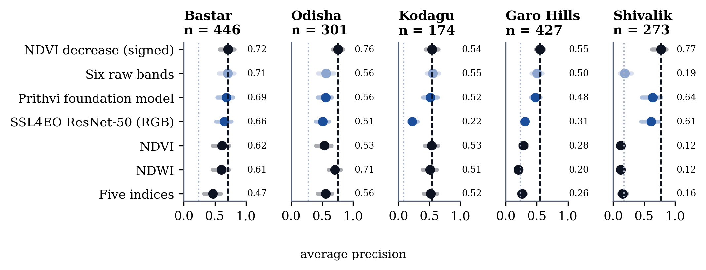
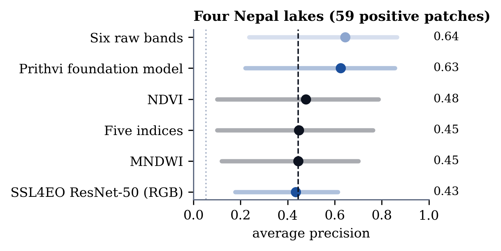
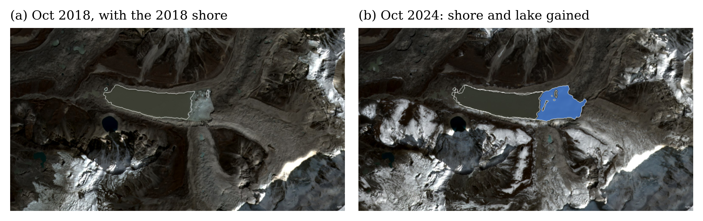
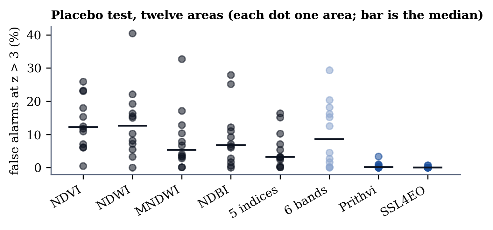

# Do geospatial foundation models detect surface change better than spectral indices? A noise-calibrated comparison on forest loss and Himalayan glacial lakes

Author: Ayush Khanal; Pragyan Kumar Singh
Affiliation: Andhra University
Status: draft for review; not yet submitted anywhere

## Abstract

Foundation models pretrained on satellite imagery are promoted for change detection, but they are rarely compared with simple spectral indices under a common standard. We score six-band reflectance, five spectral indices, a signed NDVI-decrease baseline and two foundation-model embeddings (Prithvi-EO-2.0 and an SSL4EO-S12 ResNet-50) with one rule: the change between two periods, measured in units of the scene-to-scene noise within each period, which works for feature vectors of any length. We evaluate against independent products in two fields: forest loss in five Indian areas (Hansen Global Forest Change) and water-extent change at four Nepal glacial lakes (Sentinel-1 radar). On forest loss no foundation model beats the unsupervised signed NDVI baseline in any of the five areas: Prithvi ties it in two (average precision 0.69 against 0.72 in Bastar; 0.52 against 0.54 in Kodagu) and is clearly worse in the other three (0.56 against 0.76 in Odisha, 0.48 against 0.55 in Garo Hills, 0.64 against 0.77 in the Shivalik foothills). A trained linear readout of Prithvi beats the baseline in two areas, but a readout of six raw bands does about as well. On glacial lakes Prithvi (0.63) and plain raw bands (0.64) beat the MNDWI water index (0.45) and tie each other, so the gain is not attributable to pretraining; the lake test rests mainly on two changing lakes (49 of 59 positive patches) and is limited by that. In a placebo test on twelve areas the embeddings raise 0 to 3.4% false alarms against up to 41% for indices, a calibration property rather than detection skill. All code, scene lists and checksums are released.

## 1 Introduction

Detecting where a landscape has changed between two dates is a basic task in remote sensing, and foundation models trained on millions of Sentinel-2 scenes [@szwarcman2024; @wang2022ssl4eo] are now offered as a general-purpose answer. Evidence that they beat the long-standing alternative, a spectral index such as NDVI thresholded on its difference, is thin and usually reported on benchmarks rather than against independent reference data, and almost never with the sampling noise between acquisitions taken into account. Two images of the same place never agree exactly: clouds, haze, sun angle and season change every pixel. A method that reports "change" without a notion of this noise cannot say how much of its output is real.

We ask a narrow question: when every method is judged against the same scene-to-scene noise and the same reference data, do foundation-model embeddings detect real surface change more reliably than spectral indices, and does the answer hold across fields? We contribute (i) a noise-calibrated change score that applies to any feature vector, (ii) a pre-specified evaluation in two fields (five forest areas and four glacial lakes) with spatial block bootstrap intervals, including a placebo test that needs no reference, and (iii) a negative-leaning result reported as such: no foundation model beat the best simple baseline in either field when scored without labels, and a trained linear readout of the frozen features, tried after the main evaluation, did no better than the same readout of raw reflectance.

## 2 Data and reference products

**Optical.** Sentinel-2 L2A scenes from the Element 84 Earth Search catalogue, six bands (blue, green, red, narrow NIR, SWIR1, SWIR2), cloud and snow masked with the scene classification layer. Forest periods use three clear scenes each, taken inside a single February to March window so seasonal state is matched; at three of the lakes the 2018 window had only one clear scene and the 2024 window three, so their noise scale comes from the later period alone; the fourth lake has three clear scenes in both periods.

**Forest loss.** Five areas of about 7.6 by 8 km, compared between February to March 2021 and February to March 2025. Bastar (Chhattisgarh) and Odisha were chosen first, both in central-east India. Three more were added to cover other forest types: Kodagu and Wayanad (moist evergreen forest and plantations, Western Ghats), Garo Hills (hill forest with shifting cultivation, Meghalaya) and the Shivalik foothills (sal and mixed forest, Uttarakhand). They were registered before any score was computed (`studies/forest_expansion_prereg.yaml`). Boxes centred on a stated point failed a label-only screen of at least 150 positive patches, because an arbitrary 8 km box of forest holds little recent clearing; we therefore amended the registration, still before any scene or score, so that each box is the one with the most positive patches inside a 0.4 degree window, chosen from Hansen labels alone. A fourth region, the Nepal Terai near Chitwan, failed the screen even with its best box (40 positives) and is not evaluated. As in Bastar and Odisha, the boxes therefore over-represent active clearing. The reference is Hansen Global Forest Change v1.12 [@hansen2013]. A patch is positive if at least 10% of it was lost in 2022 to 2024 and clean if under 2% was lost in 2021 to 2024; patches between the two are set aside, and only patches with at least 50% forest cover are eligible.

**Glacial lakes.** Four Nepal lakes. Three were the first pilot lakes (Tsho Rolpa, Imja Tsho, Thulagi), October to November 2018 against 2024. They held 44 positive patches, 34 of them at one lake, so we screened all 30 lakes of our Hi-MAG-based inventory [@chen2021himag] with the radar reference alone, before fetching any optical scene or computing any score, and added every other lake with at least 10 positive patches (`studies/lake_expansion_amendment.yaml`). Two lakes passed on 2018 against 2024, but neither had a clear 2018 optical scene, so the earlier period was moved to 2020 for the added lakes; repeated, the screen kept one of them (15 positive patches, radar area 1.9 to 2.2 km$^2$) and dropped the other (7). The added lake is therefore compared between October to November 2020 and 2024, and all four lakes were chosen or kept because the radar shows change at them. The reference is the change in Sentinel-1 water frequency per patch (Sentinel-1 RTC from Microsoft Planetary Computer, radar scenes within 20 days of each window, only orbits that see the lake). A patch is positive if at least 25% of it changed water state and clean if under 5% did. Radar is a different sensor from the optical data under test, so the reference is not circular, but it has its own errors.

All references are other satellite products and are treated as agreement targets, not ground truth.

## 3 Methods

### 3.1 A change score in units of noise

Each scene is reduced to one feature vector per $16 \times 16$ pixel patch (160 m). Let $\bar f_A$ and $\bar f_B$ be the mean feature vectors over the $n_A$ and $n_B$ scenes of the earlier and later period. The raw change is $D^2 = \lVert \bar f_B - \bar f_A \rVert^2$. The noise is estimated from pairs of scenes in the same period,
$$\sigma^2 = \operatorname{mean}_{i<j}\ \tfrac{1}{2}\lVert f_i - f_j \rVert^2,$$
pooled over a $3\times 3$ patch neighbourhood because three scenes give only three pairs. The score is
$$z^2 = \frac{D^2}{\sigma^2\,(1/n_A + 1/n_B)},$$
which is about 1 when nothing has changed, whatever the length or scale of the features. The HabitatShift pipeline [@habitatshift2026] already tests whether the change at a pixel exceeds the scene-to-scene spread of its own period; this score is that test written for feature vectors of any length.

### 3.2 Methods compared

All methods use the same patches and the same $z$. *Single indices* (NDVI, NDWI, MNDWI, NDBI) and *five indices together*; *six raw bands* (standardised); two embeddings, *Prithvi-EO-2.0-300M* [@szwarcman2024] (encoder only, single time step, six bands, 1,024 numbers per patch, L2 normalised) and an *SSL4EO-S12 ResNet-50* [@wang2022ssl4eo] with layer-3 features from the RGB bands only (1,024 numbers per patch). Because $z$ is unsigned, forest loss also gets a *signed NDVI-decrease* baseline, which uses the sign of the NDVI change, and which an embedding cannot provide.

### 3.3 Evaluation

The design was fixed before any score was computed (`scripts/run_fm_evaluation.py`, `scripts/run_fm_lake_evaluation.py`). We report average precision (AP) and ROC-AUC against the reference labels, with 95% intervals from a spatial block bootstrap (blocks of $8\times 8$ patches, 500 resamples) and paired differences from a named baseline resampled on the same blocks, so that spatial autocorrelation does not make intervals too narrow.

### 3.4 Placebo test

One scene of a period is compared with the rest of the same period. Nothing has changed, so every patch with $z>3$ is a false alarm. This needs no reference data and was run on twelve areas.

## 4 Results

### 4.1 Forest loss: no foundation model beats a signed NDVI baseline

@fig:forest and @tab:forest show AP against Hansen loss in five areas. No foundation model beats the signed NDVI-decrease score in any of them. Prithvi is not distinguishable from it in Bastar (0.69 against 0.72) and Kodagu (0.52 against 0.54), and clearly worse in Odisha (0.56 against 0.76), Garo Hills (0.48 against 0.55) and the Shivalik foothills (0.64 against 0.77). The RGB-only SSL4EO model is clearly worse in four areas and tied only in Bastar. Six raw bands tie the baseline in Bastar, Kodagu and Garo Hills but are far below it in Odisha and the Shivalik foothills; Prithvi is not better than raw bands in four of the five areas, and beats them only in the Shivalik foothills, where the unsigned scores of raw bands and indices are near chance (raw bands AP 0.19, AUC 0.47). Leaf state of deciduous sal forest in February to March can differ between years, which would give large unsigned change with no loss; we did not test this. At the fixed rule $z>3$ the embeddings catch more of the true loss but flag many more clean patches (Bastar: Prithvi 48% recall at 5.6% false positives, signed NDVI 24% at 0.6%); at a matched false-positive rate the baseline is at least as good. Noise calibration changes the threshold's meaning but not the ranking. Kodagu has few positives (8% of scored patches), so its AP values are low in absolute terms but well above chance.

{#fig:forest width=1.0}

Table: Forest loss in five areas, average precision (ROC-AUC). The signed NDVI-decrease score is the baseline; * means the paired difference from it, resampled on the same spatial blocks, has a 95% interval that excludes zero (every such difference is negative, so the method is worse). Positive patches: 446, 301, 174, 427 and 273. {#tab:forest}

| Score | Bastar | Odisha | Kodagu | Garo Hills | Shivalik |
|---|---|---|---|---|---|
| NDVI decrease (signed) | 0.72 (0.84) | 0.76 (0.84) | 0.54 (0.92) | 0.55 (0.78) | 0.77 (0.90) |
| Six raw bands | 0.71 (0.85) | 0.56 (0.76) * | 0.55 (0.93) | 0.50 (0.73) | 0.19 (0.47) * |
| Prithvi-EO-2.0 | 0.69 (0.88) | 0.56 (0.80) * | 0.52 (0.91) | 0.48 (0.78) * | 0.64 (0.90) * |
| SSL4EO ResNet-50 (RGB) | 0.66 (0.83) | 0.51 (0.75) * | 0.22 (0.76) * | 0.31 (0.66) * | 0.61 (0.89) * |
| NDVI (unsigned) | 0.62 (0.78) * | 0.53 (0.73) * | 0.53 (0.92) * | 0.28 (0.54) * | 0.12 (0.32) * |
| NDWI | 0.61 (0.74) * | 0.71 (0.83) * | 0.51 (0.90) * | 0.20 (0.41) * | 0.12 (0.31) * |
| Five indices | 0.47 (0.64) * | 0.56 (0.73) * | 0.52 (0.91) | 0.26 (0.52) * | 0.16 (0.44) * |

### 4.2 Glacial lakes: models beat the water index, and so do raw bands

@fig:lakes and @tab:lakes give the lake result against the radar reference, with paired intervals against MNDWI. Prithvi (AP 0.63) and six raw bands (0.64) beat MNDWI (0.45), with paired intervals that exclude zero (+0.06 to +0.22 and +0.06 to +0.24); the RGB-only model, NDVI and the five indices are not distinguishable from MNDWI. Prithvi and raw bands are indistinguishable from each other, so the improvement over MNDWI is not evidence that pretraining helps. Noise calibration helps the raw bands (0.64 with the noise-calibrated $z$, 0.20 with the raw distance) and Prithvi (0.63 against 0.35) but not the RGB-only model (0.43 against 0.70, the highest raw-distance score of all; $z$ was the pre-specified score). The result rests on 59 positive patches: 34 at Imja Tsho, which grew from about 1.1 to 1.7 km$^2$ ( @fig:imja ), 15 at the added lake, and 10 at Tsho Rolpa and Thulagi together, which stayed about the same size. So it is a test on two changing lakes, the intervals are wide (Prithvi AP 0.63, 95% interval 0.22 to 0.85), and we did not examine each lake separately. MNDWI is also a weak baseline at turbid, partly iced lakes: the optical rule's Imja area was 27% below the published outline.

{#fig:lakes width=0.6}

Table: Glacial lakes, average precision (ROC-AUC) and paired difference from MNDWI (95% interval; * excludes zero). 59 positive and 1,037 clean patches. {#tab:lakes}

| Score | AP (AUC) | Paired diff. from MNDWI |
|---|---|---|
| Six raw bands | 0.64 (0.90) | +0.06 to +0.24 * |
| Prithvi-EO-2.0 | 0.63 (0.88) | +0.06 to +0.22 * |
| NDVI | 0.48 (0.73) | -0.07 to +0.11 |
| MNDWI | 0.45 (0.76) | baseline |
| Five indices | 0.45 (0.75) | -0.07 to +0.10 |
| SSL4EO ResNet-50 (RGB) | 0.43 (0.87) | -0.23 to +0.23 |

{#fig:imja width=1.0}

### 4.3 Placebo test: embeddings are quiet, indices are not

In the placebo test on twelve areas (@fig:placebo) the two embedding models raise 0 to 3.4% false alarms at $z>3$ (medians under 0.5%), whereas indices and raw bands raise up to 41% (medians 3 to 13%). This should not be read as better detection: on Bastar, NDVI flags 23% of patches in the placebo test but only 1% of Hansen's clean patches in the real comparison, so the placebo rate depends on how alike the noise is in the two periods. A more likely reading is that embeddings vary little between scenes taken days apart but respond to differences between years (season, illumination, phenology) that the references do not count as change; we did not test this.

{#fig:placebo width=0.7}

### 4.4 A trained readout of the frozen features (exploratory)

A reviewer can fairly ask whether the embeddings do better when read out with labels, as a linear probe does. After the main evaluation we trained an L2-regularised logistic regression on the signed noise-calibrated change vector (the change in the feature vector divided by its noise scale, so its length is $z$), leaving one forest area out in turn and choosing the regularisation only inside the four training areas (`studies/probe_design.yaml`, written before the run). A probe on the six raw bands gets the same treatment as a control. Two further analyses, the paired comparison with the six-band probe and a wider regularisation grid, were added after the first run showed they were needed, and are exploratory. @tab:probe gives the result.

The Prithvi probe beats the unsupervised signed NDVI baseline in Bastar and the Shivalik foothills and ties it in the other three areas, so a trained readout does recover an advantage that the unsupervised $z$ lacks. But the six-band probe does about as well: with the original grid it is better than the Prithvi probe in Kodagu and, narrowly, Bastar, in no area is the Prithvi probe clearly better under both regularisation grids, and the probe of the RGB-only model is worse than the baseline in four areas. The chosen regularisation sat at the lowest value of the original grid in every fold, so we repeated the analysis with a wider grid; the Prithvi probe beats the baseline in the same two areas and, by a margin that only just excludes zero, in Odisha, and the comparison with the six-band probe stays unclear (it is now narrowly in favour of the six-band probe only in Garo Hills). The gain therefore comes from using labels and the sign of the change, not from pretraining. In a pooled leave-one-lake-out probe on the four lakes the Prithvi probe scores AP 0.77 against 0.61 for the six-band probe with the original grid but 0.54 against 0.39 with the wider grid, with very wide intervals (Prithvi probe minus six-band probe +0.03 to +0.35 and -0.02 to +0.29), so we do not read the lake probe as evidence.

Table: Linear probe on forest loss, average precision of the held-out area (difference with 95% block-bootstrap interval; * excludes zero). {#tab:probe}

| Area | Signed NDVI (no labels) | Prithvi probe | Prithvi probe minus signed NDVI | Six-band probe | Prithvi probe minus six-band probe | Same, wider grid |
|---|---|---|---|---|---|---|
| Bastar | 0.72 | 0.77 | +0.02 to +0.11 * | 0.81 | -0.07 to -0.00 * | -0.04 to +0.01 |
| Odisha | 0.76 | 0.79 | -0.01 to +0.07 | 0.76 | -0.00 to +0.08 | -0.01 to +0.05 |
| Kodagu | 0.54 | 0.49 | -0.11 to +0.03 | 0.55 | -0.12 to -0.01 * | -0.09 to +0.01 |
| Garo Hills | 0.55 | 0.57 | -0.03 to +0.06 | 0.59 | -0.06 to 0.00 | -0.06 to -0.00 * |
| Shivalik | 0.77 | 0.85 | +0.04 to +0.13 * | 0.80 | 0.00 to +0.13 * | -0.01 to +0.09 |

## 5 Discussion and limitations

**What the evidence supports.** For forest loss in five Indian areas, a signed NDVI-decrease score matches or beats Prithvi and a smaller RGB model in every area. For lake water change, pretrained embeddings beat the standard water index but not plain reflectance. We found no setting in which an embedding clearly beat the best simple baseline: the unsupervised scores never did, and a trained readout of Prithvi, which beat the unsupervised baseline in two forest areas, was matched by a readout of raw bands.

**What it does not.** Five forest areas, three of them chosen by a label-only search for active clearing, and two substantially changing lakes, chosen because the radar shows change at them, are too few to settle the question, three scenes per period (one in the earlier window at three lakes) is a small noise sample, and we did not test urban or wetland change, which need other reference products. An unsupervised embedding score gives no direction of change, a real limit for loss detection that the probe in Section 4.4 sidesteps by seeing the sign. Every reference is another model's output, so all scores are agreement, not accuracy. Fine-tuning a foundation model, which is how such models are usually deployed, was not tested; we tested frozen embeddings with an unsupervised score and with a linear probe. A radar water model with conformal lake-area intervals was built on the same lakes and is described in the technical report [@habitatshift2026].

## 6 Conclusion

Under a common noise standard, foundation-model embeddings did not outperform a signed vegetation baseline on forest loss, and their advantage over a water index at glacial lakes was matched by raw reflectance. A linear probe on Prithvi recovers an advantage over the unsupervised baseline in two areas, but a probe on six raw bands does about as well, so pretraining is not shown to help. Their low false-alarm rate in a placebo test is a calibration property, not evidence of detection skill. We release the pipeline, the evaluation design and all recorded outputs so that others can test further fields and fine-tuned models under the same standard.

**Reproducibility.** Code, scene lists, weight checksums and the exact numbers behind every table are in the project repository (`docs/V3_RESULTS.md`, `data/experiments/`), archived with a DOI [@habitatshift2026]. Sentinel data are free and open (Copernicus); Hansen and Hi-MAG are CC-BY 4.0; Prithvi-EO-2.0 is Apache-2.0; the SSL4EO weights are CC-BY 4.0.

## References
